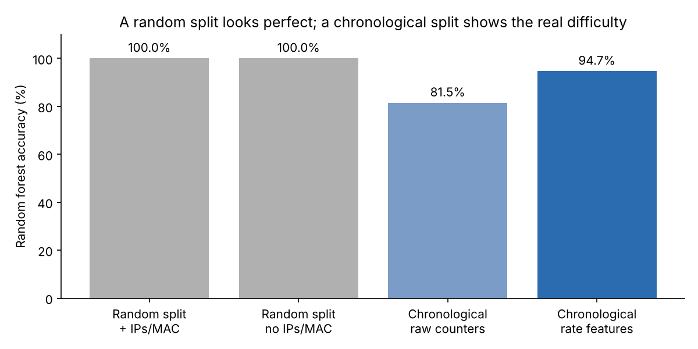
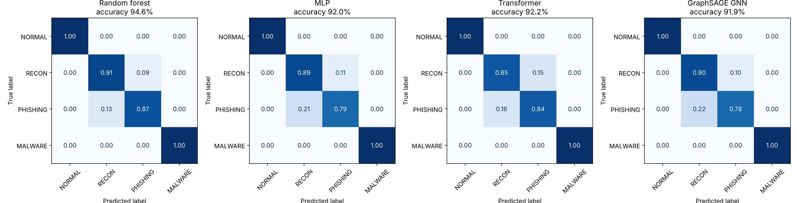
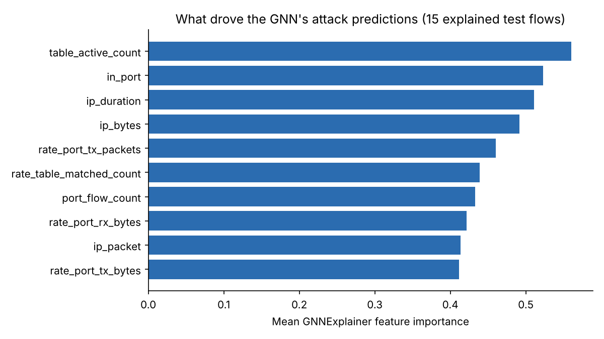

# Enhanced-MCAD: Deep Learning Intrusion Detection for Software-Defined Networks

[](https://colab.research.google.com/github/desjerez/Enhanced-MCAD/blob/main/Enhanced_MCAD.ipynb)

Enhanced-MCAD classifies Software-Defined Network (SDN) traffic as **Normal, Reconnaissance, Phishing (credential attacks) or Malware (DDoS)**. It compares a classical random forest with three deep learning models (MLP, Transformer, GraphSAGE GNN) and an ensemble, and uses **GNNExplainer** to show what drives the GNN's attack predictions.


---

## 1. A random split hides the real difficulty



| Evaluation setting | Random forest accuracy |
|---|---|
| Random split, with IP/MAC identifiers | 100.0% |
| Random split, identifiers removed | 100.0% |
| Chronological split, raw cumulative counters | 81.5% |
| **Chronological split, rate features** | **94.7%** |

Removing the IP and MAC addresses isn't enough; the random split still leaks through the counters. Under the honest chronological split, rate features add 13 points, which is more than any change of model.

## 2. Model comparison

Each model trains on 80,000 balanced flows from the first 80% of every capture and is tested on 32,000 balanced flows from the last 20%.

| Model | Accuracy | Macro F1 |
|---|---|---|
| **Random forest** (classical baseline) | **94.6%** | **0.946** |
| Ensemble (average of all four) | 93.8% | 0.937 |
| Transformer (feature-token attention) | 92.2% | 0.922 |
| MLP / deep neural network | 92.0% | 0.920 |
| GraphSAGE GNN (k-NN flow graph) | 91.9% | 0.919 |



- **Normal and Malware are separated perfectly** by every model.
- **All the errors are Recon vs. Phishing.** Both attack types were launched from the same attacker host, so their traffic looks alike.
- **Classical ML still wins on this tabular data.** The deep models came within 2–3 points but didn't beat the random forest, which matches the original MCAD study's choice of tree-based models.

## 3. Explainability



GNNExplainer scored which features mattered most for 15 correctly classified attack flows. Flow-table activity (`table_active_count`), the switch port (`in_port`) and flow duration and size led. This is the kind of evidence a SOC analyst needs to trust an alert instead of treating the model as a black box. `in_port` may partly reflect how this specific testbed was wired; see Limitations.

## How it works

1. **Load** the 14 MCAD-SDN capture files and map them to 4 classes.
2. **Remove identifiers** (source/destination IP, destination MAC) and 9 constant columns.
3. **Engineer rate features:** per-interval change of 8 cumulative counters within each capture (counter resets are treated as 0).
4. **Split chronologically:** first 80% of each capture for training, last 20% for testing; balanced sampling per class.
5. **Scale** with a signed log transform and StandardScaler, fit on training data only.
6. **Train:** a random forest, an MLP, a 2-layer / 4-head Transformer encoder over feature tokens, and a 2-layer GraphSAGE on a 10-nearest-neighbour flow graph (transductive, with train/test masks).
7. **Ensemble** by averaging class probabilities; **explain** with GNNExplainer on each node's 2-hop neighbourhood.

## Tech stack

Python · PyTorch · PyTorch Geometric · scikit-learn · pandas · NumPy · Matplotlib

## Run it

1. Click **Open in Colab** above (a CPU runtime is fine; it runs in about 5–10 minutes).
2. Download the [MCAD-SDN dataset from Kaggle](https://www.kaggle.com/datasets/lailahalman/mcad-sdn/data) and upload the zip to the Colab file panel.
3. Run all cells.

## Repository structure

```
Enhanced-MCAD/
├── Enhanced_MCAD.ipynb   # full pipeline with outputs
├── images/               # figures used in this README
└── README.md
```

## Limitations

- All traffic comes from one lab testbed. Results may not carry over to a different network.
- `in_port` and `table_active_count` may still carry testbed-specific signal.
- The GNN is transductive: test flows are nodes in the graph (labels hidden during training).

## Future work

- Test on traffic captured from a different network.
- Make the GNN inductive so it can score brand-new flows.
- Run the model inside an SDN controller (Ryu or ONOS) for live detection.

## References

- L. M. Halman and M. J. F. Alenazi, "MCAD: A Machine Learning Based Cyberattacks Detector in Software-Defined Networking (SDN) for Healthcare Systems," *IEEE Access*, vol. 11, 2023. doi:10.1109/ACCESS.2023.3266826
- L. Halman, "MCAD-SDN Dataset," Kaggle, 2024.
